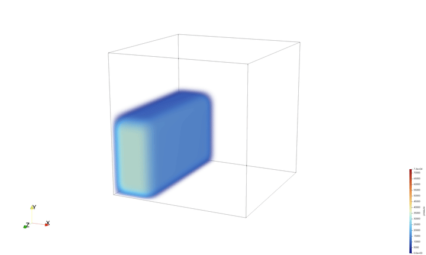
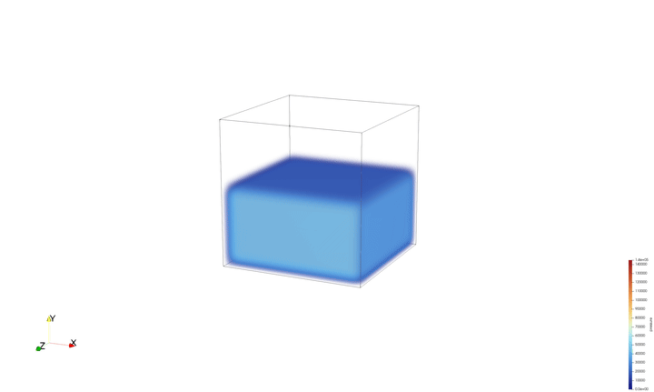
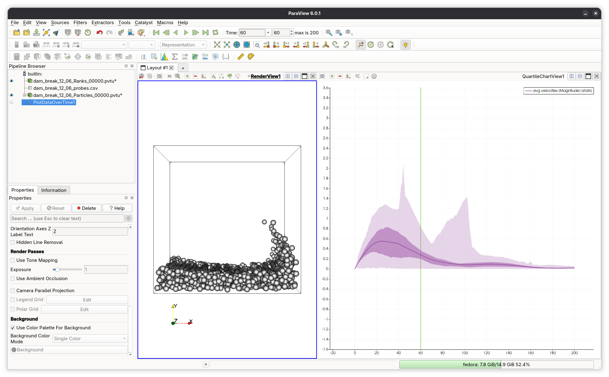
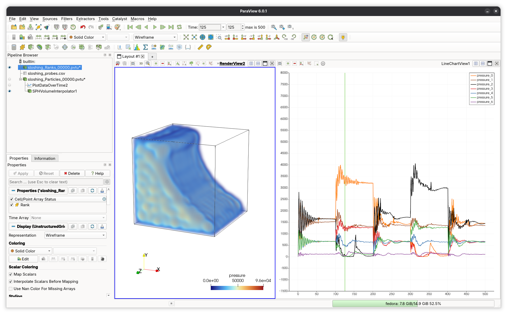
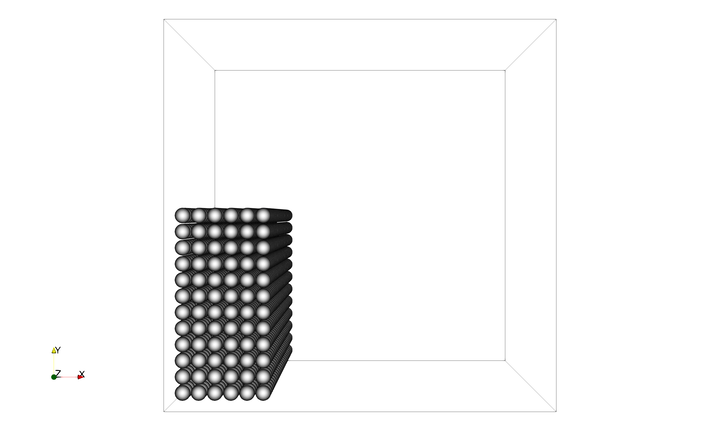
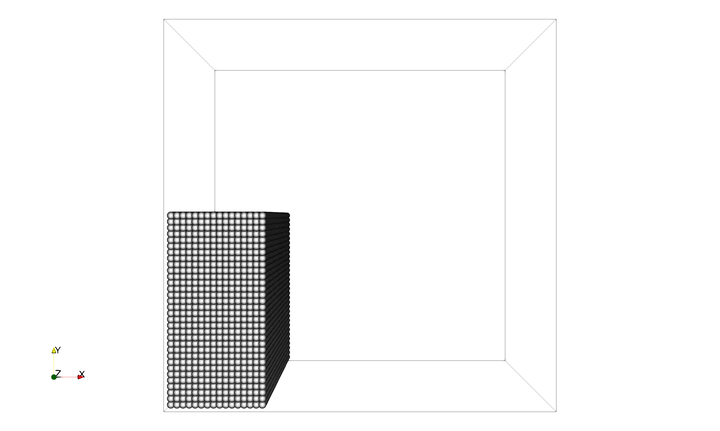

# AutoSPH

An SPH simulator built on top of the [AutoPas](https://github.com/AutoPas/AutoPas) library.

This project was developed for the Master's Thesis in Computational Science and Engineering: **Implementation of an Auto-Tuned SPH Simulator with AutoPas** by Iñigo Ruiz, advised by Manish Mishra at TUM. The thesis document is available [here](https://mediatum.ub.tum.de/1864913).

It is intended for 3D simulaton of incompressible flows.
The `input` folder contain some examples of initial configuration files.
Below are shown animations and screenshots of the output visualized with [ParaView](https://www.paraview.org/).

## Benchmark cases

### Dam Break

### Sloshing

## Paraview Analysis

## Variable Number of Particles

### 1728 Particles

### 32768 Particles

